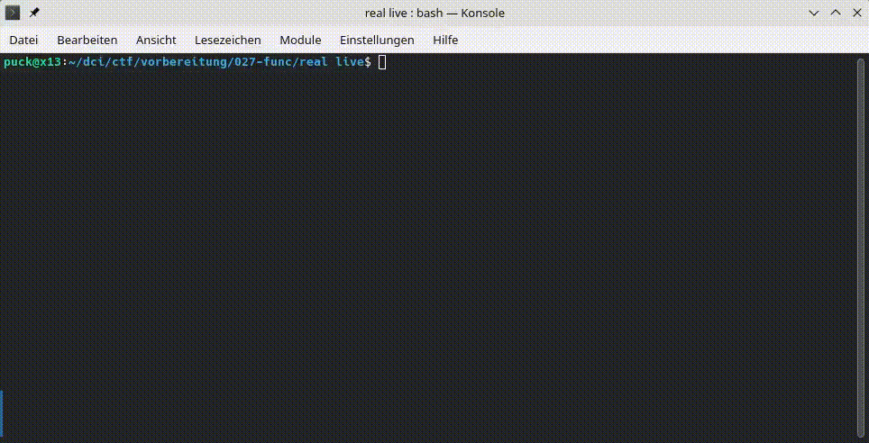

# Übung – Mini-Kiosk

Arbeite die Schritte nacheinander ab und teste nach jedem Schritt. Programmiere einen Mini-Kiosk mit diesem Menü:

- `1` – Wasser: 1,50 Euro
- `2` – Kaffee: 2,80 Euro
- `3` – Gesamtpreis anzeigen
- `4` – Beenden

Ein mögliches Ergebnis siehst du hier:

Arbeite auf deinem eigenen Branch und pushe ihn nach Abschluss deiner Arbeit zu GitHub.

## Basis

1. Zeige das Menü nach jeder Auswahl erneut an.
2. Beende das Programm bei Auswahl `4` mit `break`.
3. Addiere bei `1` den Preis für Wasser zum Gesamtpreis.
4. Addiere bei `2` den Preis für Kaffee zum Gesamtpreis.
5. Gib bei `3` den aktuellen Gesamtpreis aus.
6. Gib bei allen anderen Eingaben eine Fehlermeldung aus und beginne mit `continue` den nächsten Durchlauf.
7. Gib nach dem Beenden den endgültigen Gesamtpreis aus.

Fertig, wenn:

- mehrere Produkte nacheinander bestellt werden können
- der Gesamtpreis korrekt berechnet wird
- falsche Eingaben das Programm nicht beenden
- Auswahl `4` die Schleife kontrolliert beendet

## Wenn du Hilfe brauchst

- Die Nutzer treffen eine Auswahl anhand einer Eingabe z.B. `"1"` oder `"4"`.
- Verwende für die verschiedenen Wege `if`, `elif` und `else`.
- Der Gesamtpreis muss vor der Schleife angelegt werden. Beim Hinzufügen eines Produkts wird dessen Preis zum Gesamtpreis addiert.
- Teste zuerst nur das Beenden und ergänze danach eine Auswahl nach der anderen.

## Extras

- Zähle, wie viele Produkte bestellt wurden.
- Ergänze eine Auswahl, die den Gesamtpreis zurücksetzt.
- Lege ein Budget fest und warne, wenn der Gesamtpreis darüber liegt.
- Formatiere den Gesamtpreis mit zwei Nachkommastellen.
